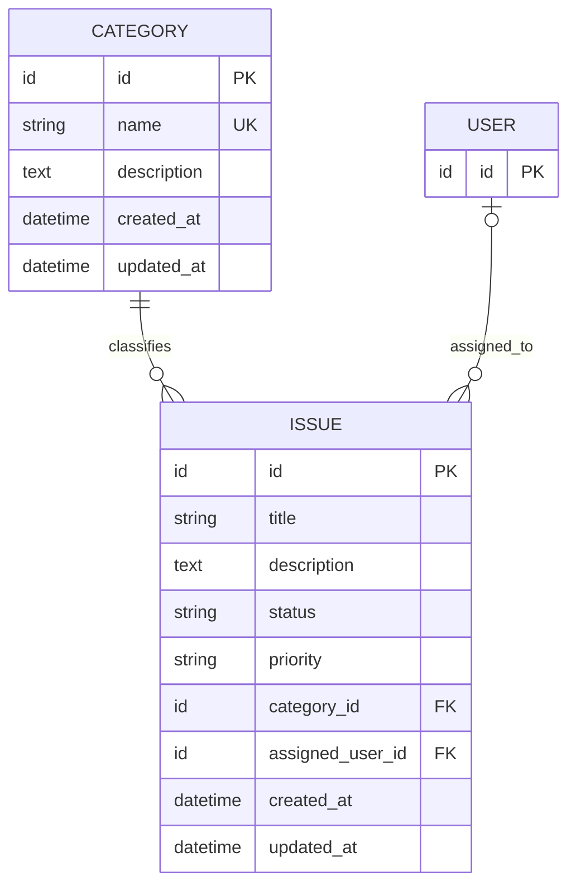

# SOFTWARE_SPECIFICATIONS.md

# Issue Tracker System — Software Specifications

**Version:** 1.1  
**Purpose:** Completion-first capstone application for *Fundamentals of AI-Driven Software Development with Claude*  
**Implementation status:** Student build target; completed instructor reference in `instructor-reference/` (see `VALIDATION.md`)  
**Backend template:** https://github.com/cloudband-solutions/default_api_fast  
**Frontend template:** https://github.com/cloudband-solutions/admin-panel-web

## 1. Project Goal

Build a small, functional web-based Issue Tracker using the existing Fast backend template and React administration-panel template. Authenticated users should be able to manage issue categories, create and update issues, assign issues to users already registered in the backend, and track work through a simple status workflow.

This document is the **source of truth for functional behavior and acceptance criteria**. The agent must inspect both repositories before selecting file paths, libraries, database APIs, authentication helpers, UI components, and exact run commands. Prefer existing template conventions over introducing new frameworks.

### Learning-focused scope

The goal is a complete vertical slice rather than a production-grade project management suite. Students should demonstrate database modeling, migrations, REST endpoints, validation, a frontend API integration, and end-to-end verification across multiple workshop sessions.

## 2. Existing Systems and Constraints

- **Backend:** `cloudband-solutions/default_api_fast` (Fast/Python API template). Reuse its routing, model, schema, service/repository, configuration, migration, and authentication conventions as found in the codebase.
- **Frontend:** `cloudband-solutions/admin-panel-web` (React). Reuse its layouts, navigation, routes, form controls, API client, styling, error handling, and authentication conventions as found in the codebase.
- **Database:** SQLite for local development, using the existing ORM and Alembic migrations. Use `sqlite:///storage/development.sqlite3` for development and `sqlite:///test.sqlite3` for tests, from the API directory. Preserve foreign-key enforcement; never point destructive tests at development data.
- **Existing `User`:** The backend already provides a `User` model. **Do not create a second user model or users table.** Reference the existing user ID using the actual type and naming convention discovered in the template.
- **Authentication:** Reuse existing login/session/token behavior; do not build a new authentication system. If the starter project does not expose user-list or authentication capabilities, report the gap and implement only the smallest compatible integration needed, after checking existing conventions.
- **Runtime:** Frontend and API run locally using direct Python and npm commands. SQLite uses local files and requires no database server or Docker. State working directories, environment variables and platform-specific interpreter paths explicitly.

> **Repository inspection requirement:** Exact file locations, URL prefixes, user identifier types, pagination conventions, and package scripts are deliberately not invented here. Inspect the repositories, document the findings, and adapt the illustrative endpoint paths below to any existing API prefix or response envelope. Preserve the logical contract.

## 3. Data Model

Only **two new persistent domain models** are required: `Category` and `Issue`.

### 3.1 Category

| Field | Type | Required | Rules |
|---|---|---|---|
| `id` | Existing project's primary-key type | Auto | Primary key |
| `name` | String (max 100) | Yes | Trim; nonblank; unique ignoring case |
| `description` | Text, nullable | No | Max 500 characters if supplied |
| `created_at` | Timestamp | Auto | Generated by server |
| `updated_at` | Timestamp | Auto | Updated by server |

Categories group related issues. Examples: **Bug**, **Feature Request**, **Task**, **Documentation**.

**Rules:**
- Category names must be unique case-insensitively. Apply both API validation and a DB-enforced uniqueness strategy appropriate to the existing database tools.
- Deleting a category with linked issues is prohibited; return `409 Conflict` with a clear error message. This avoids silently losing or orphaning issue classifications.
- Editing a category name or description must not alter the association of existing issues.

### 3.2 Issue

| Field | Type | Required | Rules |
|---|---|---|---|
| `id` | Existing project's primary-key type | Auto | Primary key |
| `title` | String (max 200) | Yes | Trim; nonblank |
| `description` | Text, nullable | No | Max 5000 characters if supplied |
| `status` | String/enum | Yes | `open`, `in_progress`, `resolved`, `closed`; default `open` |
| `priority` | String/enum | Yes | `low`, `medium`, `high`, `critical`; default `medium` |
| `category_id` | FK → `Category.id` | Yes | Must reference an existing category |
| `assigned_user_id` | Nullable FK → existing `User.id` | No | Null means unassigned; must reference an existing user if supplied |
| `created_at` | Timestamp | Auto | Generated by server |
| `updated_at` | Timestamp | Auto | Updated by server |

**Rules:**
- An issue has exactly one category.
- An issue has zero or one assigned user; one user may be assigned many issues.
- `assigned_user_id` is only a reference. Do not create, edit, or delete users as part of the Issue Tracker feature.
- Referential integrity must be enforced in the database. Follow existing backend deletion behavior for users. Where configurable without changing the existing User model's semantics, prefer `ON DELETE SET NULL` for issue assignments.
- `status` and `priority` must accept only the listed values; never silently coerce unknown values.
- For this training MVP, users may move freely between valid statuses; a workflow transition engine is out of scope.
- Issue deletion is permanent in the MVP and requires user confirmation in the UI.

### 3.3 Entity Relationship Diagram



The diagram's `USER` entity is **pre-existing** and is shown only to clarify the foreign-key relationship.

## 4. Functional Requirements

### FR-01: Category management

- List all categories alphabetically.
- Create a category with name and optional description.
- Edit a category.
- Delete a category only if it has no associated issues.
- Show a useful validation message on empty or duplicate names.

### FR-02: Issue management

- List issues and display title, category, status, priority, assigned user, and last-updated time.
- Create issues with title, optional description, required category, optional assignee, and optionally overridden status/priority.
- View an individual issue's full details.
- Edit an issue's title, description, status, priority, category, or assignee.
- Clear an assignee to make an issue unassigned.
- Delete an issue after confirmation.

### FR-03: Search and filter

- Search issues by title using case-insensitive partial matching.
- Filter issues by `status`, `priority`, `category_id`, and `assigned_user_id`.
- Support combining filters (logical AND).
- Allow the frontend to reset filters to show all issues.
- Sort issue lists by `updated_at` descending by default; use stable secondary ordering by ID.

### FR-04: Assign existing users

- Issue create/edit forms expose a selection control populated from an **existing authorized users endpoint** or another existing backend mechanism.
- Display a readable user label using actual existing fields (such as name or email), not only the user ID.
- Show **Unassigned** for null assignments.
- Validate that a non-null assignee exists. Never accept arbitrary user objects in issue mutations.

### FR-05: User feedback

- Display loading, empty, success, validation-error, and API-error states.
- After successful create/update/delete operations, update the displayed list/details so they reflect persisted server state.
- Retain sensible form values when server validation fails.

## 5. REST API Contract

The paths below are **logical endpoint paths**. Mount them under the backend's existing version/API prefix as appropriate, without introducing conflicting route conventions. Use the backend's established JSON response envelope and authentication dependencies if present; the examples below show the underlying resource representation.

### 5.1 Category endpoints

| Method | Logical route | Purpose | Success |
|---|---|---|---|
| `GET` | `/categories` | List categories | `200` |
| `POST` | `/categories` | Create category | `201` |
| `GET` | `/categories/{id}` | Get category | `200` |
| `PATCH` | `/categories/{id}` | Update category | `200` |
| `DELETE` | `/categories/{id}` | Delete unused category | `204` |

Sample create request:

```json
{
  "name": "Bug",
  "description": "Reported defects requiring investigation"
}
```

### 5.2 Issue endpoints

| Method | Logical route | Purpose | Success |
|---|---|---|---|
| `GET` | `/issues` | List, search, filter issues | `200` |
| `POST` | `/issues` | Create issue | `201` |
| `GET` | `/issues/{id}` | Get issue | `200` |
| `PATCH` | `/issues/{id}` | Partially update issue | `200` |
| `DELETE` | `/issues/{id}` | Delete issue | `204` |

Supported `GET /issues` query parameters:

| Parameter | Type | Behavior |
|---|---|---|
| `search` | String | Case-insensitive substring in title |
| `status` | Enum | Exact match |
| `priority` | Enum | Exact match |
| `category_id` | Existing ID type | Exact match |
| `assigned_user_id` | Existing User ID type | Exact match |

**MVP list response:** Use the existing backend's list/pagination conventions if any. If none exist, a JSON array is sufficient for a workshop lab; avoid inventing a new pagination framework.

Sample create request:

```json
{
  "title": "Login page displays an error",
  "description": "Submitting valid credentials results in an error message.",
  "status": "open",
  "priority": "high",
  "category_id": "11111111-1111-4111-8111-111111111111",
  "assigned_user_id": null
}
```

The UUID strings in this example are illustrative. Use IDs returned by your running API, not these example values.

Illustrative issue response:

```json
{
  "id": "22222222-2222-4222-8222-222222222222",
  "title": "Login page displays an error",
  "description": "Submitting valid credentials results in an error message.",
  "status": "open",
  "priority": "high",
  "category_id": "11111111-1111-4111-8111-111111111111",
  "assigned_user_id": null,
  "category": { "id": "11111111-1111-4111-8111-111111111111", "name": "Bug" },
  "assigned_user": null,
  "created_at": "2026-10-15T09:00:00Z",
  "updated_at": "2026-10-15T09:00:00Z"
}
```

The response should include category and assigned-user display data where practical using existing serialization patterns. Do **not** expose user passwords, credentials, tokens, or sensitive account fields.

For a partial update, omitted fields remain unchanged; explicit `assigned_user_id: null` clears the assignment.

### 5.3 Existing users integration

Use the pre-existing backend API to list selectable users. If no compatible user-list endpoint is available, implement the smallest **read-only authenticated endpoint** using existing User handling, and avoid introducing user CRUD functionality. Return only the ID and safe display fields required by the dropdown.

### 5.4 Error behavior

- `400` or existing backend validation convention: malformed query parameters.
- `401` / `403`: missing authentication / insufficient permissions, following existing template rules.
- `404 Not Found`: nonexistent issue, category, or referenced user/category where applicable.
- `409 Conflict`: duplicate category name or attempting to delete a category still used by issues.
- `422 Unprocessable Entity` (or the template's established validation code): invalid field values, missing required fields, or excessive field lengths.
- `204 No Content` for successful deletion; no JSON response body.

Errors must have predictable machine-readable shape and human-readable text, consistent with the backend template. Do not leak stack traces to clients.

## 6. React Frontend Requirements

Use the existing admin-panel layout and component library. Add navigation entries without replacing unrelated template pages.

### 6.1 Pages

| Page | Suggested route | Features |
|---|---|---|
| Issues list | `/issues` | Table, search, combined filters, New Issue button, edit/view actions, delete confirmation |
| Issue form | `/issues/new` and `/issues/:id/edit` | Create/edit fields, category dropdown, existing-user dropdown, submit/cancel |
| Issue details | `/issues/:id` | Full issue details, Edit button, back navigation |
| Categories | `/categories` | List, add, edit, and delete categories; inline form or modal is acceptable |

The frontend may use equivalent paths if the existing routing structure requires them.

### 6.2 UI conventions

- All form controls must have visible labels.
- Required fields are visibly marked.
- Status and priority appear as readable labels (badges optional).
- Category and user selectors are populated from backend data, not hard-coded IDs.
- Existing design system controls and confirmation modals should be preferred over new packages.
- API base URL must use the frontend's environment/config mechanism, never a hard-coded machine-specific address.
- Use the existing authentication credential mechanism with API calls.
- Display helpful empty states (e.g., "No issues match the selected filters").
- Make layouts usable at desktop sizes and avoid unusable controls on smaller screens.

## 7. Database and Seed Data

- Implement database migrations for `categories` and `issues` using the backend's current tooling.
- Preserve the existing `users` table and all existing user data.
- Add foreign keys and supporting indexes for `category_id` and `assigned_user_id`; add others only as justified.
- Use UTC or the template's consistent timezone handling for timestamps.
- Provide an **idempotent seed** for the four sample categories: Bug, Feature Request, Task, Documentation.
- Optional sample issues may be seeded using real existing category IDs. Do not assume any User ID exists or fabricate users just to seed assignments.

## 8. Security and Data Integrity

- Use the existing backend authentication and authorization approach on all issue/category endpoints and the assignee selector endpoint.
- Enforce validation and foreign-key integrity server-side, regardless of frontend checks.
- Parameterize DB queries or use existing ORM mechanisms; do not concatenate untrusted inputs into SQL.
- Never log secrets or include sensitive User attributes in issue responses.
- Avoid introducing authorization roles, per-issue visibility, notifications, or audit logging for this training MVP unless they already exist in the templates.

## 9. Verification and Test Requirements

### Backend

Test at minimum:

1. Category create, list, update, delete.
2. Blank category name and case-insensitive duplicate name are rejected.
3. Category referenced by an issue cannot be deleted.
4. Issue create, retrieve, update, delete.
5. Missing/blank issue title and invalid status/priority are rejected.
6. Creating an issue with nonexistent category or user is rejected.
7. Issue can be assigned to an existing user and later unassigned.
8. Search and combined filters return the expected issues.
9. Protected endpoints respect the existing authentication policy.

### Frontend and end-to-end

Confirm at minimum:

1. Existing login/auth flow still works where applicable.
2. Categories appear in the issue form selector.
3. An issue created through the browser appears in the issue list after saving.
4. Editing its status, priority, category, and assignee persists after reload.
5. Filtering and searching shows only matching issues; reset restores the full list.
6. Delete asks for confirmation and removes the issue on success.
7. Attempting to delete an in-use category shows the conflict clearly.
8. Frontend build succeeds and backend tests pass.

## 10. Definition of Done

The MVP is complete when all of the following are true:

- [ ] The backend and frontend run locally, connected to SQLite.
- [ ] Only `Category` and `Issue` are added as new domain models.
- [ ] `Issue.assigned_user_id` references the existing backend `User` model.
- [ ] Database migrations apply successfully on a fresh development database.
- [ ] Categories support CRUD with protected deletion when in use.
- [ ] Issues support CRUD, status, priority, category, and optional assigned user.
- [ ] Issues support search and the required filters.
- [ ] React pages use real backend endpoints; no mock data is needed for core workflows.
- [ ] Validation errors, loading states, and delete confirmation are handled.
- [ ] Basic automated backend tests pass and the frontend builds without errors.
- [ ] A manual browser demonstration covers: create category → create issue → assign user → change status → filter → delete issue.
- [ ] Setup instructions identify actual commands/environment variables for running both repositories and their separate SQLite development/test files.

## 11. Out of Scope for the Workshop MVP

Do not implement these unless explicitly requested after the MVP is complete:

- User registration, new user table, profile editing, or new login system.
- Issue comments, attachments, activity feed, email notifications, or mentions.
- Sprints, projects, subtasks, dependencies, boards, or drag-and-drop Kanban.
- Custom status workflows, SLA tracking, analytics dashboards, or export.
- Real-time WebSockets, background jobs, third-party integrations, or production deployment.
- Over-engineered service abstractions, unrelated codebase refactors, or new UI libraries.

## 12. Instructions to the Claude Development Agent

**Read this file completely before implementation.**

### Step 1 — Explore (no edits yet)

1. Inspect the backend and frontend repositories, including README files and any `CLAUDE.md` or `AGENTS.md` instructions.
2. Identify the existing User model, primary-key type, authentication methods, authorized user-list endpoint, DB/migration conventions, route prefixes, response envelopes, API client, and frontend components.
3. Report any material discrepancies between this specification and the actual templates. Distinguish an implementation detail that can be adapted from a functional requirement that must remain intact.
4. Propose a short, ordered implementation plan and verification commands before modifying files.

### Step 2 — Implement in small, testable increments

1. Add database models/migrations and seed categories.
2. Add Category schemas/validation/endpoints and tests.
3. Add Issue schemas/validation/endpoints, associations, search/filters, and tests.
4. Connect read-only existing-user selection.
5. Add the React navigation, pages/forms, and API integrations.
6. Run tests/build and manually exercise the full workflow.

### Step 3 — Verify and report

- Run the smallest relevant checks after each increment and broad checks at the end.
- Summarize changed files, architectural decisions, routes, migrations, tests, and any known limitations.
- Do not claim tests or manual checks passed unless they were actually run.
- Do not introduce major dependencies, rewrite authentication, change the User model contract, or refactor unrelated code without explicit approval.
- If template constraints make a requirement impossible, stop and describe the conflict and smallest viable resolution rather than silently dropping functionality.

## 13. Suggested Student Demonstration

In a running browser session:

1. Open Categories and add **Bug** if it does not already exist.
2. Create an issue titled **Login page displays an error**, mark priority **High**, and choose the **Bug** category.
3. Choose an existing user as assignee, if the backend has a suitable user.
4. Change the status from **Open** to **In Progress**.
5. Filter by **High** priority and **In Progress** status to locate the issue.
6. Open the issue, verify that persisted details match the form, and remove its assignment.
7. Delete the issue after confirmation, then verify that it no longer appears in the list.

**Success means the frontend, backend, and database are genuinely integrated**, not merely displaying hard-coded sample data.
